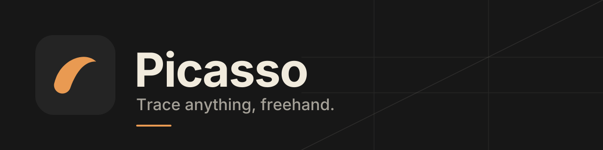
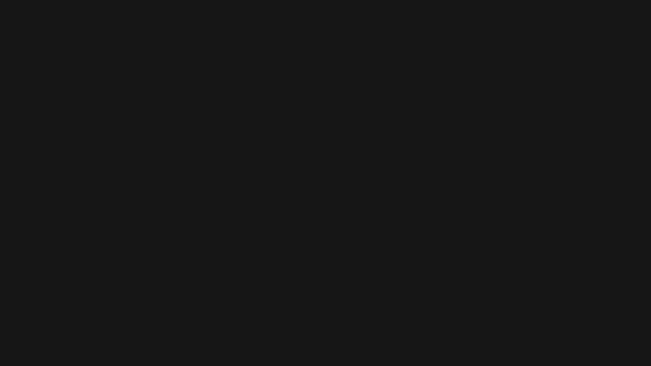
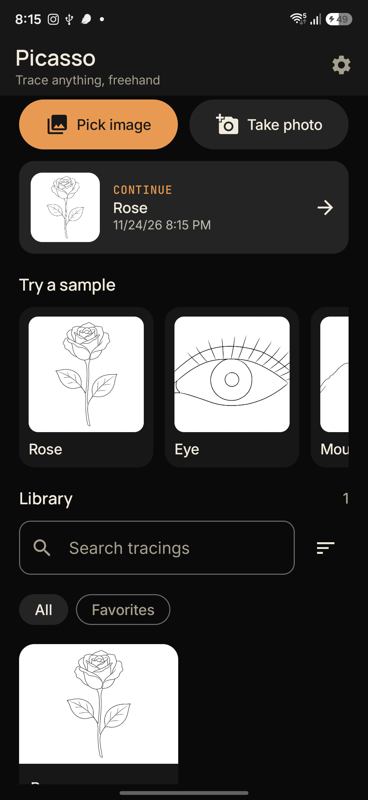
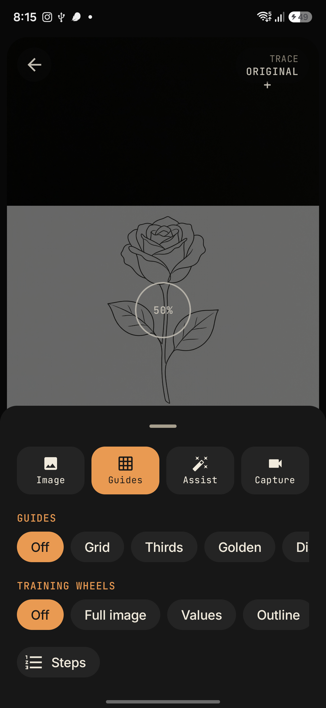
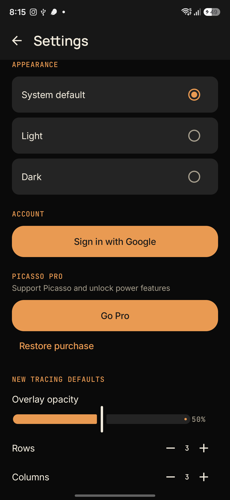
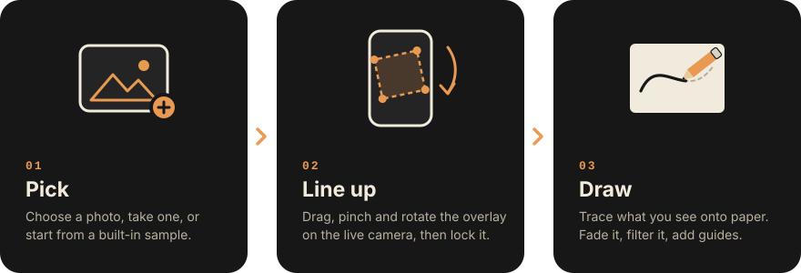
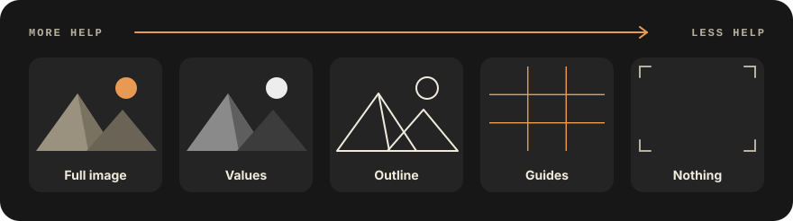
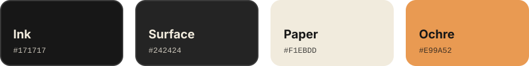

<p align="center">
  
</p>

<h3 align="center">Trace anything, freehand.</h3>

<p align="center">
  A live camera under a translucent reference image,<br>
  so you can draw it onto paper.
</p>

<p align="center">
  <a href="https://github.com/alekslime/Picasso/releases"></a>
</p>

<p align="center">
  
  
  
  
</p>

<p align="center">
  <a href="#screenshots">Screenshots</a> &nbsp;·&nbsp;
  <a href="#how-it-works">How it works</a> &nbsp;·&nbsp;
  <a href="#features">Features</a> &nbsp;·&nbsp;
  <a href="#get-picasso">Get Picasso</a> &nbsp;·&nbsp;
  <a href="#for-developers">For developers</a>
</p>

<br>

<p align="center">
  
</p>

<!-- After running ./scripts/demo.sh (writes assets/demo.gif), uncomment this:
<p align="center">
  
</p>
-->

## Screenshots

<table>
  <tr>
    <td align="center" width="33%"><br><sub><b>Library</b></sub></td>
    <td align="center" width="33%"><br><sub><b>Trace</b></sub></td>
    <td align="center" width="33%"><br><sub><b>Tools · Image</b></sub></td>
  </tr>
  <tr>
    <td align="center"><br><sub><b>Tools · Guides</b></sub></td>
    <td align="center"><br><sub><b>Training wheels</b></sub></td>
    <td align="center"><br><sub><b>Settings</b></sub></td>
  </tr>
</table>

## How it works

<p align="center">
  
</p>

## Features

<table>
  <tr>
    <td width="50%" valign="top">

<h3> Trace</h3>

- Full-screen camera with a slim dock: lock, flip, torch, reset and opacity
- A Tools sheet for everything else, in four short tabs
- Landscape layout with the dock beside the camera

<h3> Look</h3>

- Filters: original, grayscale, high contrast, outline, value study
- Brightness and contrast for tricky lighting
- Layers: add more references, swap, fade or rename each one

<h3> Guides</h3>

- Grid, thirds, golden ratio and diagonals, drawn as 1dp lines
- Adjustable grid rows and columns

    </td>
    <td width="50%" valign="top">

<h3> Learn</h3>

- **Training wheels** that take help away as you improve (see below)
- Drawing steps that build the image up in stages
- Compare flash to blink between your drawing and the reference

<h3> Capture</h3>

- Video recording with optional audio
- Timelapse frames every 5, 10 or 30 seconds
- Before/after image saved to your gallery
- Wall mode: a full-screen reference for projectors and TVs

<h3> More</h3>

- **AR anchor (beta):** keeps the overlay fixed on the paper as the phone moves
- **Library:** samples, favorites, search, sort, rename, delete
- A home-screen widget to continue your last tracing

    </td>
  </tr>
</table>

### Training wheels

Start with the full reference, then let the app fade it out as you get better:
full image, values, outline, guides only, and finally nothing.

<p align="center">
  
</p>

## Privacy

> Your work stays on your device. No server, no sync, no analytics.

Read the full policy in [PRIVACY.md](PRIVACY.md).

## License

Copyright © 2026 alekslime. All rights reserved. The source is visible for
reference only; see [LICENSE](LICENSE).

## Get Picasso

Grab the APK from [**Releases**](https://github.com/alekslime/Picasso/releases),
or from CI artifacts on any green build. Requires **Android 8.0 (API 26)** or newer.

<br>

## For developers

### Build from source

```sh
./gradlew testDebugUnitTest   # unit tests
./gradlew assembleDebug       # app/build/outputs/apk/debug/app-debug.apk
./gradlew installDebug        # install on a connected device
```

Needs **JDK 17** and **Android SDK 36**. The app builds and runs without any API
keys: ads, billing and sign-in degrade gracefully until you configure them.

**Built with** Jetpack Compose · Material 3 · CameraX · ARCore · Room · DataStore · Hilt

<details>
<summary><b>Project layout</b></summary>

```
app/src/main/java/app/picasso/tracer/
├── ui/
│   ├── home/          library and home screen
│   ├── trace/         camera, dock, tools sheet, overlay, guides
│   ├── settings/      theme, account, Pro, defaults
│   ├── nav/           navigation
│   └── theme/         colors, type, theme
├── camera/            CameraX, ARCore anchor, motion tracking
├── filters/           GPU and bitmap filters, step generator
├── data/              Room database, image store, settings
├── domain/            models and repository interfaces
├── monetization/      ads, billing, Google sign-in
├── widget/            home-screen widget
└── di/                Hilt modules
```

</details>

<details>
<summary><b>Design</b></summary>

<br>



<br>

Set in Manrope, Inter and JetBrains Mono. Thin-line guides, rounded corners and a
dark, camera-first layout. See the [Figma file](https://www.figma.com/design/ljeyvNGO9gyLMxrjECzr7Z).

</details>

<details>
<summary><b>Updating the screenshots and demo GIF</b></summary>

<br>

With an emulator running or a phone connected (USB debugging on):

```sh
./scripts/screenshots.sh        # or: python3 scripts/screenshots.py
```

It installs the debug build if needed, starts the app from a clean state, taps
through every screen on its own and saves the six PNGs to `assets/screenshots/`.
Pass `--serial <id>` if more than one device is attached. It clears Picasso's app
data first, so don't run it on a device with tracings you want to keep.

The demo GIF works the same way and records itself while it drags, locks, fades
and flips the overlay and steps through the training-wheels levels:

```sh
./scripts/demo.sh               # writes assets/demo.gif (needs ffmpeg)
```

</details>

<details>
<summary><b>More docs</b></summary>

- [Releasing and Play Store signing](docs/RELEASING.md)
- [Ads, billing and sign-in setup](docs/MONETIZATION.md)
- [Privacy policy](PRIVACY.md)

</details>