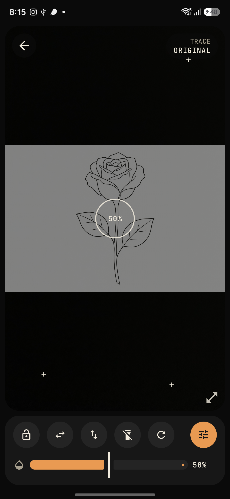
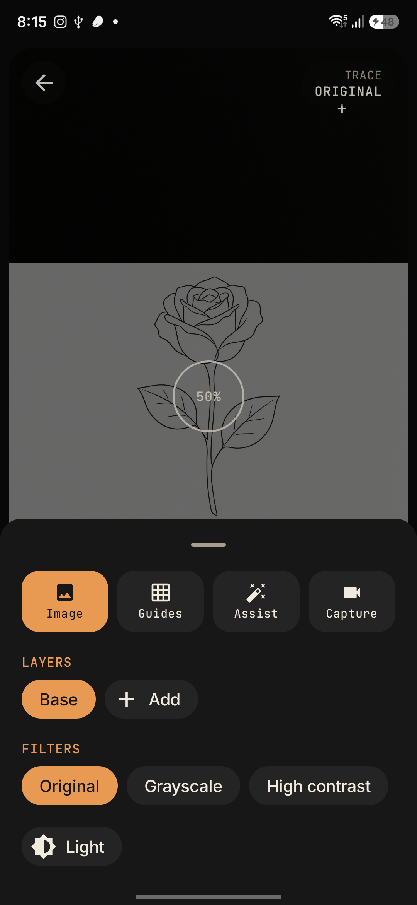
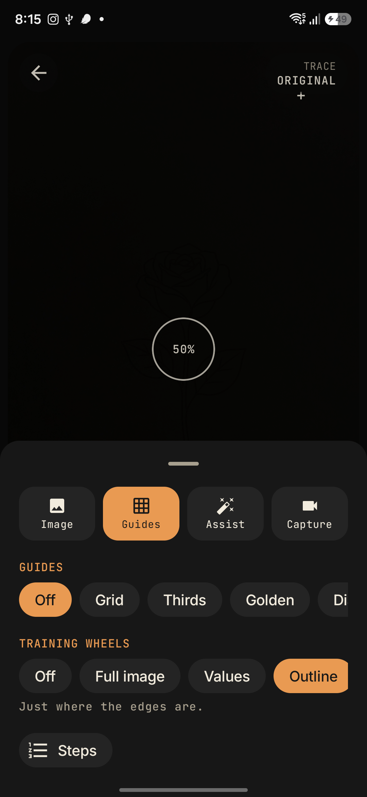

<p align="center">
  <b>Trace anything, freehand.</b><br>
  A live camera under a translucent reference image, so you can draw it onto paper.
</p>

<p align="center">
  <a href="https://github.com/alekslime/Picasso/releases"></a>
  
  
  
</p>

## Screenshots

<table>
  <tr>
    <td align="center"><br><sub>Library</sub></td>
    <td align="center"><br><sub>Trace</sub></td>
    <td align="center"><br><sub>Tools: Image</sub></td>
  </tr>
  <tr>
    <td align="center"><br><sub>Tools: Guides</sub></td>
    <td align="center"><br><sub>Training wheels</sub></td>
    <td align="center"><br><sub>Settings</sub></td>
  </tr>
</table>

## How it works

1. **Pick a reference.** Choose a photo, take one, or start from a built-in sample.
2. **Line it up.** Drag, pinch and rotate the overlay on the live camera, then lock it.
3. **Draw.** Trace what you see onto paper. Fade the overlay, change its look, or add guides as you go.

## Features

**Trace**
- Full-screen camera with a slim control dock: lock, flip, torch, reset and an opacity slider
- A Tools sheet for everything else, grouped into four tabs so you only see what you need
- Landscape layout with the dock beside the camera

**Look**
- Filters: original, grayscale, high contrast, outline, value study
- Brightness and contrast tuning for tricky lighting
- Layers: add extra references, swap between them, fade or rename each one

**Guides**
- Grid, thirds, golden ratio and diagonal guides, drawn as 1dp lines
- Adjustable grid rows and columns

**Learn**
- **Training wheels:** the reference fades from the full image to values, outline, guides only, and finally nothing
- Drawing steps that build the image up in stages
- Compare flash to blink between your drawing and the reference

**Capture**
- Video recording with optional audio
- Timelapse frames every 5, 10 or 30 seconds
- Before/after image saved to your gallery
- Wall mode: full-screen reference for projectors and TVs

**AR anchor (beta)**
- Keeps the overlay fixed on the paper as the phone moves

**Library**
- Samples, favorites, search, sort, rename and delete
- "Continue last tracing" home-screen widget

## Privacy

Your work stays on your device. There is no server, no sync and no analytics.
See [PRIVACY.md](PRIVACY.md).

## Download

Grab the APK from [Releases](https://github.com/alekslime/Picasso/releases), or
from CI artifacts on any green build.

Requires Android 8.0 (API 26) or newer.

## Build from source

```sh
./gradlew testDebugUnitTest   # unit tests
./gradlew assembleDebug       # app/build/outputs/apk/debug/app-debug.apk
./gradlew installDebug        # install on a connected device
```

Needs JDK 17 and Android SDK 36. The app builds and runs without any API keys:
ads, billing and sign-in degrade gracefully until you configure them.

## Project layout

```
app/src/main/java/app/picasso/tracer/
├── ui/
│   ├── home/          library and home screen
│   ├── trace/         camera, dock, tools sheet, overlay, guides
│   ├── settings/      theme, account, Pro, defaults
│   ├── nav/           navigation
│   └── theme/         colors, type, theme
├── camera/            CameraX, ARCore anchor, motion tracking
├── filters/           GPU and bitmap filters, step generator
├── data/              Room database, image store, settings
├── domain/            models and repository interfaces
├── monetization/      ads, billing, Google sign-in
├── widget/            home-screen widget
└── di/                Hilt modules
```

Built with Jetpack Compose, Material 3, CameraX, ARCore, Room, DataStore and Hilt.

## Design

Ink `#171717` · Surface `#242424` · Paper `#F1EBDD` · Ochre `#E99A52`,
set in Manrope, Inter and JetBrains Mono. Thin-line guides, rounded corners, a
dark camera-first layout.
[Figma file](https://www.figma.com/design/ljeyvNGO9gyLMxrjECzr7Z)

## Docs

- [Releasing and Play Store signing](docs/RELEASING.md)
- [Ads, billing and sign-in setup](docs/MONETIZATION.md)
- [Privacy policy](PRIVACY.md)

## Updating the screenshots

<<<<<<< HEAD
With a device or emulator connected and the debug build installed:

```sh
./scripts/screenshots.sh
```

It walks you through each screen and saves PNGs to `assets/screenshots/`.
=======
With an emulator running or a phone connected (USB debugging on):

```sh
./scripts/screenshots.sh        # or: python3 scripts/screenshots.py
```

It installs the debug build if needed, starts the app from a clean state,
taps through every screen on its own and saves the six PNGs to
`assets/screenshots/`. Pass `--serial <id>` if more than one device is attached.
It clears Picasso's app data first, so don't run it on a device with tracings
you want to keep.
>>>>>>> ee74ee7 (Add monetization and releasing documentation, and automate screenshot capture)
